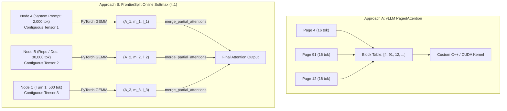

# Disaggregated Attention & Weightless Context Engines: Foundations, Hardware Mapping, and Multi-Tier Chunking

## Abstract

Modern long-context inference (32k–1M+ tokens) is bounded by memory capacity and memory bandwidth rather than compute FLOPs. While the industry has predominantly approached disaggregation through raw Key-Value (KV) cache migration over high-bandwidth RDMA fabrics ("Data-to-Compute"), **FrontierSplit** introduces a "Compute-to-Data" architecture centered on a **Weightless Context Server** and **Exact Online Softmax Rescaling**. 

This document formalizes the mathematical invariants, hardware silicon mechanics (GPU Tensor Cores vs. TPU Systolic Arrays), byte-level communication limits, two-tier chunking derivations (Split-K), and distributed scheduling policies developed during architectural review. It serves as the primary technical foundation for subsequent academic and industry whitepapers.

---

## 1. Mathematical Invariant: Attention as an Associative Reduction

Standard multi-head scaled dot-product attention computes:

$$\operatorname{Attention}(Q, K, V) = \operatorname{softmax}\left(\frac{Q K^T}{\sqrt{d_k}}\right) V$$

Given a single decoding query $q \in \mathbb{R}^{1 \times d_k}$ and a sequence of $N$ historical key-value pairs partitioned arbitrarily into $P$ non-overlapping subsets $\mathcal{S}_1, \mathcal{S}_2, \dots, \mathcal{S}_P$ such that $\bigcup_{p=1}^P \mathcal{S}_p = \{1, \dots, N\}$:

For each partition $p \in \{1, \dots, P\}$, let $K_p \in \mathbb{R}^{N_p \times d_k}$ and $V_p \in \mathbb{R}^{N_p \times d_v}$. We define the **partial attention statistics tuple** $(A_p, m_p, \ell_p)$:

$$s_{p, j} = \frac{q \cdot K_{p, j}^T}{\sqrt{d_k}} \quad \forall j \in \{1, \dots, N_p\}$$

$$m_p = \max_{j \in \{1, \dots, N_p\}} s_{p, j}$$

$$\ell_p = \sum_{j=1}^{N_p} e^{s_{p, j} - m_p}$$

$$A_p = \sum_{j=1}^{N_p} e^{s_{p, j} - m_p} V_{p, j} \quad \in \mathbb{R}^{1 \times d_v}$$

### Exact Associative Rescaling Operator ($\oplus$)

Given any two disjoint partitions with statistics $(A_1, m_1, \ell_1)$ and $(A_2, m_2, \ell_2)$, they combine into a joint statistic $(A_{12}, m_{12}, \ell_{12}) = (A_1, m_1, \ell_1) \oplus (A_2, m_2, \ell_2)$ via:

$$m_{12} = \max(m_1, m_2)$$

$$\ell_{12} = \ell_1 \cdot e^{m_1 - m_{12}} + \ell_2 \cdot e^{m_2 - m_{12}}$$

$$A_{12} = A_1 \cdot e^{m_1 - m_{12}} + A_2 \cdot e^{m_2 - m_{12}}$$

The true global attention output is obtained by final scalar division:

$$O = \frac{A_{\text{global}}}{\ell_{\text{global}}}$$

### Properties of the $\oplus$ Operator
1. **Associativity**: $(X \oplus Y) \oplus Z = X \oplus (Y \oplus Z)$. Partitions can be grouped and reduced in arbitrary order or tree hierarchies.
2. **Commutativity**: $X \oplus Y = Y \oplus X$. Physical storage ordering across shards or blocks does not alter numerical output.
3. **Bit-for-Bit Exactness**: When computed in identical floating-point precision (FP32), $O$ matches monolithic single-pass attention with zero mathematical approximation.

---

## 2. Communication Complexity: The 8.25 KB Derivation

In modern open-weights architectures (e.g., Llama 3 8B, Mistral 7B, Mixtral 8x7B):
- Number of Query Heads ($H_q$): $32$
- Head Dimension ($d_k = d_v$): $128$
- Total Model Hidden Size: $H_q \times d = 32 \times 128 = 4{,}096$

### Why the Partial Attention Response is 8.25 KB (Not 32 Bytes)
If a remote context machine only returned the softmax normalizers ($m_p$ and $\ell_p$), the decode worker would still require the raw Value vectors $V_p$ to compute $\sum \text{softmax}(S) \cdot V$. But $V_p$ is the multi-gigabyte cache.

By executing the contraction with $V$ **remotely on the Context Server**, the $N$-token sequence collapses into a single 1-token output vector:

$$\underbrace{S_p}_{[32, 1, N]} \times \underbrace{V_p}_{[32, N, 128]} = \underbrace{A_p}_{[32, 1, 128]}$$

| Payload Component | Tensor Dimensions | Precision | Size |
| :--- | :--- | :--- | :--- |
| **Query Request ($Q$)** | $[1, 32, 1, 128]$ | FP16 (2 bytes) | **$8{,}192\text{ bytes}$ ($8.0\text{ KB}$)** |
| **Partial Accumulator ($A_p$)** | $[1, 32, 1, 128]$ | FP16 (2 bytes) | **$8{,}192\text{ bytes}$ ($8.0\text{ KB}$)** |
| **Max Logit Vector ($m_p$)** | $[1, 32, 1, 1]$ | FP32 (4 bytes) | **$128\text{ bytes}$** |
| **Sum-of-Exp Vector ($\ell_p$)** | $[1, 32, 1, 1]$ | FP32 (4 bytes) | **$128\text{ bytes}$** |
| **Frame Framing / Metadata** | Struct header | — | **$\sim 64\text{ bytes}$** |
| **Total RPC Response** | | | **$\approx 8{,}512\text{ bytes}$ ($8.25\text{ KB}$)** |

### Bandwidth Compression Ratio
For a 100,000-token prompt:
- **Raw KV Migration (vLLM / Mooncake / LMCache)**:
  $$100{,}000\text{ tokens} \times 4{,}096\text{ dim} \times 2 \times 2\text{ (K and V)} = \mathbf{1{,}600\text{ MB (1.6 GB)}}$$
- **FrontierSplit Compute-to-Data RPC**:
  $$8.0\text{ KB (Send)} + 8.25\text{ KB (Receive)} = \mathbf{16.25\text{ KB}}$$
- **Compression Advantage**: $\mathbf{98{,}461\times}$ reduction in wire bandwidth.

---

## 3. Hardware Silicon Mapping: GPU vs. TPU Mechanics

```
┌────────────────────────────────────────────────────────────────────────┐
│                   OFF-CHIP MEMORY (VRAM / HBM)                         │
│   • High capacity (16 GB – 96 GB per chip)                             │
│   • Holds stationary KV cache (Gigabytes)                              │
│   • Bandwidth limited: 1–3 TB/s                                        │
└───────────────────────────────────┬────────────────────────────────────┘
                                    │ Memory Bus Stream (Tile-by-Tile)
                                    ▼
┌────────────────────────────────────────────────────────────────────────┐
│                   ON-CHIP PROCESSOR (GPU SM / TPU Core)                │
│  ┌──────────────────────────────────────────────────────────────────┐  │
│  │ Fast Local Registers / SRAM / VMEM (100 KB – 32 MB)              │  │
│  │ ► Q stays PINNED here for entire decode step (256 bytes per head)│  │
│  └──────────────────────────────────┬───────────────────────────────┘  │
│                                     │ 1-Cycle Internal Bus             │
│                                     ▼                                  │
│  ┌──────────────────────────────────────────────────────────────────┐  │
│  │ Multiply-Accumulate Execution Grid (Tensor Cores / Systolic Array│  │
│  │ • TPU MXU: 128 x 128 physical grid (16,384 multipliers)          │  │
│  │ • Computes (Q in registers) x (Streaming K chunk from VRAM)      │  │
│  └──────────────────────────────────────────────────────────────────┘  │
└────────────────────────────────────────────────────────────────────────┘
```

### 3.1 The Decode Asymmetry ($M=1$)
During autoregressive generation ($M=1$ token):
1. **$Q$ fits entirely in on-chip registers**:
   - $Q$ is $[1, 128]$ per head $\approx 256$ bytes.
   - It is loaded across the memory bus **exactly once** at the beginning of the kernel.
   - It remains stationary in registers across all clock cycles.
2. **$K$ is streamed in chunks**:
   - The memory bus streams chunks of $K$ past the stationary $Q$.
   - Each byte of $K$ is read from VRAM/HBM **only once**.
3. **Execution is 100% Memory-Bandwidth Bound**:
   - Compute FLOPs take nanoseconds; latency is determined solely by the speed of reading the KV cache from off-chip memory.

### 3.2 TPU Systolic Array Realities ($128 \times 128$ MXU)
- A single TPU Matrix Multiply Unit (MXU) contains a physical grid of $128 \times 128 = 16{,}384$ physical multiplier units.
- **Contracting Dimension ($d=128$)**: The head dimension of standard LLMs ($128$) matches the hardware width of the MXU array directly.
- **Token Dimension ($N$)**: Sizing KV cache blocks in multiples of 128 tokens ensures that $K^T$ $[128, N]$ tiles evenly across the 128-column grid with zero unused multiplier columns.
- **XLA Static Shape Requirement**: If chunk lengths vary dynamically (e.g. 1,843 tokens vs. 1,844 tokens), Google's XLA compiler halts execution to compile new machine code graphs. Quantizing cache storage into **128-token blocks** eliminates XLA recompilation entirely: the kernel for shape $[128, 128]$ is compiled once and reused across all sessions.

---

## 4. The Two-Tier Chunking Architecture (Derivation of Split-K)

When $M = 1$, a single user only supplies 1 row to the 128-tall hardware multiplier array. Running a single row leaves the remaining 127 rows idle.

This motivates **Two-Tier Chunking**:

```
                       KV Cache Sequence (e.g. 16,384 tokens)
  ┌──────────────┬──────────────┬──────────────┬──────────────┬──────────────┐
  │   Chunk 0    │   Chunk 1    │   Chunk 2    │     ...      │  Chunk 127   │
  │ (128 tokens) │ (128 tokens) │ (128 tokens) │              │ (128 tokens) │
  └───────┬──────┴───────┬──────┴───────┬──────┴──────────────┴───────┬──────┘
          │              │              │                             │
          ▼              ▼              ▼                             ▼
     ┌─────────┐    ┌─────────┐    ┌─────────┐                   ┌─────────┐
     │  Row 0  │    │  Row 1  │    │  Row 2  │                   │ Row 127 │
     └────┬────┘    └────┬────┘    └────┬────┘                   └────┬────┘
          │              │              │                             │
          ▼              ▼              ▼                             ▼
     (A_0,m_0,l_0)  (A_1,m_1,l_1)  (A_2,m_2,l_2)               (A_127,m_127,l_127)
          │              │              │                             │
          └──────────────┴──────────────┴─────────────────────────────┘
                                        │
                                        ▼ Online Softmax Reduction (Within Chip)
                               Final Attention Output
```

1. **Tier 1 (Horizontal / Tile Size)**: Sized to 128 tokens to saturate the inner contracting dimension of the multiplier line.
2. **Tier 2 (Vertical / Spatial Parallelism - Split-K)**: Instead of a single row processing Chunk 0 through Chunk 127 sequentially, the 128 chunks are dispatched across **128 parallel compute lines / cores simultaneously for that single user**.
3. **The Unification**: The reduction of those 128 partial results on-chip uses the **exact same Online Softmax operator ($\oplus$)** as FrontierSplit's cross-machine reduction.

---

## 5. Memory Management: Radix Nodes vs. Page Tables (Review 4.1)

### The PyTorch Strided Memory Constraint
Physical silicon has no requirement that memory be contiguous; the memory controller can read from arbitrary non-sequential addresses with zero latency penalty.

The requirement for contiguity is an artifact of high-level software libraries:
- Standard PyTorch `torch.matmul` requires uniform strides ($\text{Address} = \text{Base} + i \cdot \text{Stride}$).
- PyTorch has no native tensor constructor for arbitrary scattered memory pointers.

### Architectural Approaches to Non-Contiguous Caching



- **vLLM PagedAttention**: Chops memory into tiny 16-token physical blocks. Because a 10k prompt has 625 pages, a Python loop is impossible; it requires thousands of lines of custom C++/CUDA kernels to traverse the block table on the GPU.
- **FrontierSplit Radix Node Attention (4.1)**:
  - Chunks are **large semantic nodes** (e.g. 2k-token system prompt, 30k-token repository).
  - Each individual node is an internally contiguous PyTorch tensor.
  - A request spans only 2 or 3 nodes.
  - Calling PyTorch on Node A and Node B and merging with `merge_two_partial_attentions` takes **microseconds**, with **zero custom C++ dependencies** and **zero `torch.cat` memory copying**.

---

## 6. Distributed Context Fabric: Cloud Topology, Sizing, and Multi-User Scheduling

This section establishes the operational methodology for deploying, sizing, and scheduling a distributed FrontierSplit cluster across multi-tenant production traffic.

### 6.1 Model Slicing & Vertical Layer Allocation ($L_c$)
The cluster administrator sizes compute nodes according to model weight footprint and hardware bandwidth:
- A model with $L$ total transformer layers (e.g., $L = 32$) is vertically partitioned into $S$ pipeline stages, allocating $L_c = L / S$ contiguous layers per compute stage (e.g., $L_c = 8$ layers across 4 nodes).
- **Execution Boundary**: Each compute stage executes its assigned layers in local GPU VRAM. The boundary between compute stages is strictly the intermediate activation tensor ($\sim 16\text{ KB}$ per token).
- While compute stages host model weights, Key-Value caches for all $L_c$ layers are disaggregated to the Context Fabric.

### 6.2 Separation of Compute & Context, and the Remainder Optimization ($N \pmod{128}$)
Compute workers (model weight nodes) and Context Servers remain strictly disaggregated:
- Compute workers hold model weights and maintain a **small, volatile local KV cache** (`LocalOutputKVCache` / `DynamicCache`) dedicated to newly generated output tokens and incoming delta prefill tokens.
- **The Remainder Optimization**: When an arbitrary prompt of $N$ tokens is registered:
  $$\text{Tiled Context} = \lfloor N / 128 \rfloor \times 128$$
  $$\text{Remainder} = N \pmod{128}$$
  - The clean $128$-token blocks are offloaded to the Context Server, guaranteeing 100% hardware tile saturation with **zero masked positions**.
  - The ragged remainder tokens ($< 128$) are retained directly in the compute worker's existing local volatile cache, alongside newly generated tokens.
  - The attention merge becomes:
    $$O = \operatorname{Remote}(\text{Tiled Context}) \oplus \operatorname{Local}(\text{Remainder} + \text{Output Tokens})$$
  - This eliminates tail padding waste and XLA recompilation on the Context Server without requiring any new local memory structures.

### 6.3 Analytical Multi-Machine Sharding Trigger
The decision to keep a prompt on a single Context Machine vs. sharding across $P$ machines is governed by an analytical roofline cost model:

Let:
- $K = \text{number of 128-token blocks in the prompt}$.
- $T_{\text{cycle}} = \text{time to stream one 128-token block from local VRAM/HBM}$.
- $T_{\text{network}} = \text{persistent binary TCP RPC roundtrip latency } (\approx 0.5\text{ ms})$.

$$\text{Latency on 1 Machine: } T_{\text{single}} = K \times T_{\text{cycle}}$$
$$\text{Latency Sharded across } P \text{ Machines: } T_{\text{sharded}} = \left(\frac{K}{P} \times T_{\text{cycle}}\right) + T_{\text{network}}$$

The Gateway shards across $P$ machines if and only if the memory streaming savings exceed the network latency tax:

$$\left(1 - \frac{1}{P}\right) K \times T_{\text{cycle}} > T_{\text{network}}$$

If a prompt is small, network latency dominates $\to$ **retain on 1 machine**. If a prompt is massive (e.g. 500k–1M+ tokens), memory streaming dominates $\to$ **shard across $P$ machines**, dropping single-stream decode latency by nearly $P\times$.

### 6.4 Layer Stacking & Deterministic Temporal Interleaving
For a single conversational stream, transformer layers are evaluated strictly sequentially:
$$L_0 \to \text{MLP}_0 \to L_1 \to \text{MLP}_1 \to \dots \to L_{31} \to \text{MLP}_{31}$$

- **Layer Stacking**: A user session's KV caches for all $L$ layers are co-located on the same Context Server. At any given instant, that session only queries a single layer.
- **Eliminating the Idle Bubble**: While the compute worker evaluates the feed-forward MLP ($\text{MLP}_i$) and layer norms, the Context Server experiences a deterministic idle window of duration $T_{\text{MLP}}$.
- By staggering concurrent user requests by phase offsets of $\Delta t \approx T_{\text{MLP}}$, the Context Server interleaves Layer $j$ of User B into the idle window of User A:
  ```text
  Context Server: [User A: L0] ──► [User B: L4] ──► [User C: L12] ──► [User A: L1] ...
  ```
  The Context Server’s memory bus and compute cores achieve 100% continuous temporal utilization.

### 6.5 Multi-User Allocation: The $K_{\text{sat}}$ Sizing Spectrum & Lockstep Prevention
In multi-tenant environments, the distribution of chunks per machine dictates cluster queuing stability. We define $K_{\text{sat}}$ as the **hardware saturation threshold**—the exact number of chunks that saturates a machine's execution cores/bandwidth in a single parallel pass (e.g. 16 blocks of 128 tokens $\approx 2{,}048$ tokens).

The architecture identifies three distinct allocation regimes:

```text
1. Under-Saturation (1 Chunk per Machine):
   • Each machine only holds 1 chunk of a user's KV cache.
   • Disaster in multi-user systems: If 10 users share the same chunk placement,
     they all queue up for their first chunk on Machine 1 simultaneously.
   • Accidental Lockstep / Spatial Convoy: Machine 1 is 100% crushed while Machine 2
     and Machine 3 sit at 0% idle. As requests finish, the convoy marches to Machine 2,
     leaving Machine 1 dead.
   • Excessive network fan-out (16–64 network RPCs per step).

2. Saturated Allocation (Exactly K_sat Chunks per Machine) — [TARGET ARCHITECTURE]:
   • A user's prompt is allocated in discrete units of K_sat chunks per machine.
   • Single-user decode runs at 100% hardware efficiency in a single parallel pass.
   • Zero fractional bubbles; minimizes network RPC fan-out to ceil(Prompt / K_sat).
   • Eliminates the lockstep convoy: each machine processes a self-contained, fully
     saturated compute slice without inter-node micro-synchronization stalls.

3. Oversubscription (> K_sat Chunks per Machine):
   • Machine holds multiple passes of chunks (e.g., 4 x K_sat), cycling through them
     sequentially in 4 passes.
   • Trades higher single-user latency (4x slower) for zero multi-machine network overhead.
   • Optimal for low-cost clusters with slow network interconnects.
```

### 6.6 Hot Prefix Replication via Active Reader Reference Counting
Popular shared prefixes (e.g., standard system prompts, repository codebases in SWE-bench swarms) create hotspot read bottlenecks if pinned to a single machine:
- Every cached node in the `RadixPrefixCache` tracks an `active_reader_count`.
- When `active_reader_count` exceeds a provisioned threshold (e.g. $> 64$ concurrent streams), the Context Fabric automatically clones the node to secondary Context Servers as **Read Replicas**.
- The Gateway's `PrefixRouter` distributes incoming 8 KB queries across replicas using Power-of-Two choices or weighted round-robin.
- When `active_reader_count` subsides, replicas expire gracefully under their standard sliding TTL window.

### 6.7 Reasoning Trace Commit Policy (Review 4.3)
During multi-turn conversational interactions (e.g., chain-of-thought code generation):
- **Short Assistant Replies ($< 500$ tokens)**: Retained locally on the compute worker's volatile cache; discarded from Context Server on stream completion. Worker folds them into Delta Prefill on Turn 2, avoiding distributed network synchronization overhead on exit.
- **Long Reasoning Traces ($> 4{,}000$ tokens)**: Committed via `append_kv` to the Context Server at turn completion as clean 128-token blocks. Subsequent conversational turns avoid re-running delta prefill over thousands of reasoning tokens.

---

## 7. Summary for Paper Framing

| Architectural Dimension | Traditional Industry Approach | FrontierSplit Approach | Primary Advantage |
| :--- | :--- | :--- | :--- |
| **KV Disaggregation** | RDMA KV Migration (Data-to-Compute) | Online Softmax RPC (Compute-to-Data) | $98{,}461\times$ less network traffic; runs on standard VPC Ethernet |
| **Context Node Attention** | Physical tensor concatenation (`torch.cat`) | Associative reduction ($\oplus$) over Radix nodes | Zero memory duplication; instant $O(1)$ prefix branching |
| **Compute Parallelism** | Batching multiple users ($M \gg 1$) | Two-tier chunking (Split-K across rows/shards) | High hardware saturation even for single-user ($M=1$) decode |
| **Hardware Portability** | Custom vendor-specific CUDA/C++ kernels | Pure PyTorch with tile-aligned blocks | Runs natively on GPUs, TPUs, CPUs without compilation churn |
| **Tail Padding Handling** | Zero-padding with attention masks | Remainder Optimization ($N \pmod{128}$) on Worker | 100% hardware efficiency on Context Server; zero padding bubbles |
| **Multi-Machine Sizing** | Heuristic / arbitrary chunk scatter | $K_{\text{sat}}$ Saturated Allocation Spectrum | Prevents spatial convoy / lockstep; saturates single-pass compute |
| **Hot Prefix Scaling** | Static single-node pinning | Active Reader Ref-Counting with Read Replicas | Eliminates query queue congestion on popular shared prefixes |
