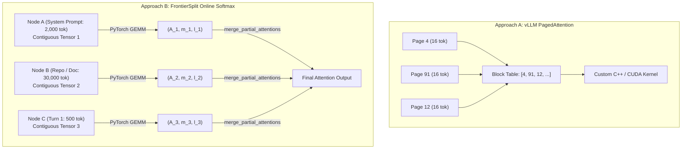

# Disaggregated Attention & Weightless Context Engines: Foundations, Hardware Mapping, and Multi-Tier Chunking

## Abstract

Modern long-context inference (32k–1M+ tokens) is bounded by memory capacity and memory bandwidth rather than compute FLOPs. While the industry has predominantly approached disaggregation through raw Key-Value (KV) cache migration over high-bandwidth RDMA fabrics ("Data-to-Compute"), **FrontierSplit** introduces a "Compute-to-Data" architecture centered on a **Weightless Context Server** and **Exact Online Softmax Rescaling**. 

This document formalizes the mathematical invariants, hardware silicon mechanics (GPU Tensor Cores vs. TPU Systolic Arrays), byte-level communication limits, two-tier chunking derivations (Split-K), and distributed scheduling policies developed during architectural review. It serves as the primary technical foundation for subsequent academic and industry whitepapers.

---

## 1. Mathematical Invariant: Attention as an Associative Reduction

Standard multi-head scaled dot-product attention computes:

$$\operatorname{Attention}(Q, K, V) = \operatorname{softmax}\left(\frac{Q K^T}{\sqrt{d_k}}\right) V$$

Given a single decoding query $q \in \mathbb{R}^{1 \times d_k}$ and a sequence of $N$ historical key-value pairs partitioned arbitrarily into $P$ non-overlapping subsets $\mathcal{S}_1, \mathcal{S}_2, \dots, \mathcal{S}_P$ such that $\bigcup_{p=1}^P \mathcal{S}_p = \{1, \dots, N\}$:

For each partition $p \in \{1, \dots, P\}$, let $K_p \in \mathbb{R}^{N_p \times d_k}$ and $V_p \in \mathbb{R}^{N_p \times d_v}$. We define the **partial attention statistics tuple** $(A_p, m_p, \ell_p)$:

$$s_{p, j} = \frac{q \cdot K_{p, j}^T}{\sqrt{d_k}} \quad \forall j \in \{1, \dots, N_p\}$$

$$m_p = \max_{j \in \{1, \dots, N_p\}} s_{p, j}$$

$$\ell_p = \sum_{j=1}^{N_p} e^{s_{p, j} - m_p}$$

$$A_p = \sum_{j=1}^{N_p} e^{s_{p, j} - m_p} V_{p, j} \quad \in \mathbb{R}^{1 \times d_v}$$

### Exact Associative Rescaling Operator ($\oplus$)

Given any two disjoint partitions with statistics $(A_1, m_1, \ell_1)$ and $(A_2, m_2, \ell_2)$, they combine into a joint statistic $(A_{12}, m_{12}, \ell_{12}) = (A_1, m_1, \ell_1) \oplus (A_2, m_2, \ell_2)$ via:

$$m_{12} = \max(m_1, m_2)$$

$$\ell_{12} = \ell_1 \cdot e^{m_1 - m_{12}} + \ell_2 \cdot e^{m_2 - m_{12}}$$

$$A_{12} = A_1 \cdot e^{m_1 - m_{12}} + A_2 \cdot e^{m_2 - m_{12}}$$

The true global attention output is obtained by final scalar division:

$$O = \frac{A_{\text{global}}}{\ell_{\text{global}}}$$

### Properties of the $\oplus$ Operator
1. **Associativity**: $(X \oplus Y) \oplus Z = X \oplus (Y \oplus Z)$. Partitions can be grouped and reduced in arbitrary order or tree hierarchies.
2. **Commutativity**: $X \oplus Y = Y \oplus X$. Physical storage ordering across shards or blocks does not alter numerical output in real arithmetic.
3. **Exact Mathematical Decomposition with Floating-Point Numerical Precision**: In real arithmetic, the $\oplus$ reduction operator is strictly exact with zero theoretical approximation error. However, when evaluated in IEEE 754 floating-point arithmetic (FP32), altering the reduction order across sequence partitions introduces slight non-associative floating-point summation rounding errors (e.g. maximum absolute differences on the order of $\sim 2.98 \times 10^{-7}$). Consequently, `torch.equal` is false while `torch.allclose` passes with standard tolerance ($\text{atol} = 10^{-5}$). As explicitly documented in the [PyTorch Numerical Accuracy Notes](https://docs.pytorch.org/docs/main/notes/numerical_accuracy.html), mathematically equivalent operations evaluated in different summation orders are not guaranteed to be bitwise identical.

---

## 2. Communication Complexity: The 16.7 KB Response & GQA KV Bandwidth

In modern open-weights architectures (e.g., Llama 3 8B, Mistral 7B, Mixtral 8x7B):
- Number of Query Heads ($H_q$): $32$
- Number of Key-Value Heads ($H_{\text{kv}}$): $8$ (Grouped-Query Attention with $4:1$ ratio)
- Head Dimension ($d = d_k = d_v$): $128$
- Total Model Hidden Size: $H_q \times d = 32 \times 128 = 4{,}096$

### Why the Partial Attention Response is ~16.7 KB (Not 32 Bytes or 8.25 KB)
If a remote context machine only returned the softmax normalizers ($m_p$ and $\ell_p$), the decode worker would still require the raw Value vectors $V_p$ to compute $\sum \text{softmax}(S) \cdot V$. But $V_p$ is the multi-gigabyte cache.

By executing the contraction with $V$ **remotely on the Context Server**, the $N$-token sequence collapses into a single 1-token output vector:

$$\underbrace{S_p}_{[32, 1, N]} \times \underbrace{V_p}_{[32, N, 128]} = \underbrace{A_p}_{[32, 1, 128]}$$

To preserve numerical stability and prevent exponent underflow/overflow during multi-chunk online softmax reductions, the Context Server returns the partial accumulator $A_p$ in **FP32** (4 bytes per element) rather than FP16:

| Payload Component | Tensor Dimensions | Precision | Size |
| :--- | :--- | :--- | :--- |
| **Query Request ($Q$)** | $[1, 32, 1, 128]$ | FP16 (2 bytes) | **$8{,}192\text{ bytes}$ ($8.0\text{ KB}$)** |
| **Partial Accumulator ($A_p$)** | $[1, 32, 1, 128]$ | FP32 (4 bytes) | **$16{,}384\text{ bytes}$ ($16.0\text{ KB}$)** |
| **Max Logit Vector ($m_p$)** | $[1, 32, 1, 1]$ | FP32 (4 bytes) | **$128\text{ bytes}$** |
| **Sum-of-Exp Vector ($\ell_p$)** | $[1, 32, 1, 1]$ | FP32 (4 bytes) | **$128\text{ bytes}$** |
| **Binary Protocol Header / Framing** | 16-byte fixed header + JSON metadata | — | **$\sim 79\text{ bytes}$** |
| **Total RPC Response Wire Size** | | | **$\approx 16{,}719\text{ bytes}$ ($16.33\text{ KB}$)** |
| **Total Roundtrip Wire Footprint** | Send + Receive | | **$\approx 24{,}991\text{ bytes}$ ($24.40\text{ KB}$)** |

### GQA KV Cache Sizing & Bandwidth Comparison

In Grouped-Query Attention (GQA), the memory footprint of Key and Value caches depends on $H_{\text{kv}}$ ($8$ heads), not $H_q$ ($32$ heads):

$$\text{KV footprint per token per layer} = 2 \times H_{\text{kv}} \times d \times 2\text{ bytes (FP16)} = 2 \times 8 \times 128 \times 2 = 4{,}096\text{ bytes} = \mathbf{4.0\text{ KB}}$$

For a 100,000-token prompt:
- **Raw KV Cache per Layer**:
  $$100{,}000\text{ tokens} \times 4{,}096\text{ bytes} = \mathbf{409.6\text{ MB per layer}}$$
- **Full Model Raw KV Cache (32 layers)**:
  $$32 \times 409.6\text{ MB} = \mathbf{13.11\text{ GB}}$$

### Traffic Comparison Formulation: Single-Step vs. Total Workload
Comparing a single decode RPC against a full cache migration illustrates the instantaneous transfer compression, but full workload bandwidth depends on generated tokens ($T_{\text{gen}}$), layer count ($L$), initial uploads, commits, and prefix cache hits:

1. **Full-Cache Migration (e.g. vLLM / Mooncake / LMCache)**:
   $$\text{Traffic}_{\text{mig}} = L \times (2 \times H_{\text{kv}} \times d \times 2) \times N_{\text{prompt}}$$
   Migrating the entire 100k cache once transfers **$13.11\text{ GB}$**.

2. **FrontierSplit Compute-to-Data RPC**:
   $$\text{Traffic}_{\text{disagg}} = L \times T_{\text{gen}} \times (Q_{\text{bytes}} + A_{p,\text{bytes}} + \text{framing}) + \text{Uploads}_{\text{initial}} + \text{Commits}_{\text{reasoning}}$$

- **Instantaneous Single-Layer Decode Step**:
  Transfers $24.99\text{ KB}$ roundtrip vs. $409.6\text{ MB}$ raw KV migration $\to \mathbf{16{,}390\times}$ reduction in wire transfer for that step.
- **Multi-Turn Generation Example ($T_{\text{gen}} = 10$ tokens with warm prefix)**:
  - Cache migration: transfers $13.11\text{ GB}$ upfront before generating.
  - FrontierSplit: transfers $32\text{ layers} \times 10\text{ tokens} \times 24.99\text{ KB} \approx \mathbf{8.00\text{ MB}}$ total roundtrip traffic $\to \mathbf{1{,}638\times}$ overall bandwidth reduction.
- **Long Generation Regime**:
  As $T_{\text{gen}}$ scales into tens of thousands of tokens without prompt reuse, total RPC traffic grows linearly with $T_{\text{gen}} \times L$, defining the operational crossover point where local KV caching or turn-boundary commits are favored.

---

## 3. Hardware Silicon Mapping: GPU vs. TPU Mechanics

```
┌────────────────────────────────────────────────────────────────────────┐
│                   OFF-CHIP MEMORY (VRAM / HBM)                         │
│   • High capacity (16 GB – 96 GB per chip)                             │
│   • Holds stationary KV cache (Gigabytes)                              │
│   • Bandwidth limited: 1–3 TB/s                                        │
└───────────────────────────────────┬────────────────────────────────────┘
                                    │ Memory Bus Stream (Tile-by-Tile)
                                    ▼
┌────────────────────────────────────────────────────────────────────────┐
│                   ON-CHIP PROCESSOR (GPU SM / TPU Core)                │
│  ┌──────────────────────────────────────────────────────────────────┐  │
│  │ Fast Local Registers / SRAM / VMEM (100 KB – 32 MB)              │  │
│  │ ► Q stays PINNED here for entire decode step (256 bytes per head)│  │
│  └──────────────────────────────────┬───────────────────────────────┘  │
│                                     │ 1-Cycle Internal Bus             │
│                                     ▼                                  │
│  ┌──────────────────────────────────────────────────────────────────┐  │
│  │ Multiply-Accumulate Execution Grid (Tensor Cores / Systolic Array│  │
│  │ • TPU MXU: 128 x 128 physical grid (16,384 multipliers)          │  │
│  │ • Computes (Q in registers) x (Streaming K chunk from VRAM)      │  │
│  └──────────────────────────────────────────────────────────────────┘  │
└────────────────────────────────────────────────────────────────────────┘
```

### 3.1 The Decode Asymmetry ($M=1$)
During autoregressive generation ($M=1$ token):
1. **$Q$ fits entirely in on-chip registers**:
   - $Q$ is $[1, 128]$ per head $\approx 256$ bytes.
   - It is loaded across the memory bus **exactly once** at the beginning of the kernel.
   - It remains stationary in registers across all clock cycles.
2. **$K$ is streamed in chunks**:
   - The memory bus streams chunks of $K$ past the stationary $Q$.
   - Each byte of $K$ is read from VRAM/HBM **only once**.
3. **Execution is Memory-Bandwidth Bound**:
   - Compute FLOPs execute in nanoseconds; latency is determined predominantly by reading the KV cache from off-chip memory.
   - Memory controller throughput relies on wide burst accesses (typically 64-byte or 128-byte cache lines); fine-grained, arbitrary pointer-chasing introduces address translation and bus turnaround penalties, making contiguous chunking essential.

### 3.2 TPU Systolic Array Considerations & Matrix Architecture
- **Systolic Array Mechanics**: Unlike general-purpose CPU cores or GPU thread schedulers where 128 rows represent independently schedulable program counters, a TPU Matrix Multiply Unit (MXU) is a physical 2D grid of multiplier-accumulators operating in rigid lockstep dataflow.
- **TPU Hardware Generations**: Hardware configurations vary across generations. TPU v2 and v3 feature $128 \times 128$ physical systolic arrays. In contrast, newer generations such as TPU v4, TPU v5e, and TPU v5p deploy evolved matrix execution units (e.g., dual $128 \times 128$ arrays in v4, smaller or specialized dimensional tiles in v5e).
- **Tiling Alignment**: Sizing KV cache blocks in uniform multiples (such as 128 tokens) aligns with contracting dimensions and hardware tile boundaries, amortizing padding waste.
- **XLA Graph Compilation**: Google XLA compiles static computational graphs for fixed tensor dimensions. Using quantized, predictable chunk sizes minimizes the frequency of dynamic shape recompilations across conversational turns.

---

## 4. The Three-Tier Chunking Architecture (Line → Grid → Multi-Unit Fabric)

Partitioning the sequence dimension during decode attention and reducing partial accumulators using online softmax was pioneered by **Flash-Decoding (Dao et al., 2023)**. FrontierSplit extends this sequence-partitioning principle from within a single GPU SM to a distributed multi-tenant context fabric, structuring KV cache memory across a three-tier hardware hierarchy:

```
                          KV Cache Sequence (e.g. 65,536 tokens)
   ┌────────────────────────────────────────────────────────────────────────┐
   │ Tier 3: Multi-Compute Unit Fabric (e.g. 4 MXUs / N_SM Streaming Multiprocessors) │
   │  ┌───────────────────────┬───────────────────────┬──────────────────┐  │
   │  │   Compute Unit 0      │   Compute Unit 1      │      ...         │  │
   │  │   (16,384 tokens)     │   (16,384 tokens)     │                  │  │
   └──┴───────────┬───────────┴───────────┬───────────┴──────────────────┴──┘
                  │                       │
      ┌───────────▼───────────┐           ▼
      │ Tier 2: 128 Grid Rows │
      │ ┌───────────────────┐ │
      │ │ Chunk 0 (128 tok) │ │
      │ ├───────────────────┤ │
      │ │ Chunk 1 (128 tok) │ │
      │ ├───────────────────┤ │
      │ │ ...               │ │
      │ ├───────────────────┤ │
      │ │ Chunk 127(128 tok)│ │
      │ └─────────┬─────────┘ │
      └───────────┼───────────┘
                  │
      ┌───────────▼────────────────────────────────────────┐
      │ Tier 1: Horizontal Vector Line (128 Numbers)       │
      │ • Fills inner contracting dot-product dimension    │
      └────────────────────────────────────────────────────┘
                  │
                  ▼ Online Softmax Reduction (Within Chip & Across Nodes)
              Final Attention Output: O = Part_0 ⊕ Part_1 ⊕ ... ⊕ Part_P
```

1. **Tier 1 (Horizontal / Vector Line Alignment)**: Sized to 128 tokens (matching `head_dim` $d=128$) to saturate the inner contracting dimension of one multiplier line, eliminating horizontal ALU idling.
2. **Tier 2 (Vertical / Single Unit Grid Rows)**: Sized to 128 chunks ($128 \times 128 = 16{,}384$ tokens) to saturate all 128 vertical multiplier rows of a single physical systolic array (or one SM's active warp execution slots).
3. **Tier 3 (Multi-Compute Unit Fabric Multiplier)**: Sized across the chip's total physical compute units ($U_{\text{compute}}$). On a TPU with 4 MXUs ($2\text{ cores} \times 2\text{ MXUs}$), single-stream sequence saturation requires $16{,}384 \times 4 = \mathbf{65{,}536\text{ tokens}}$ ($512$ chunks of 128).
4. **The Unification**: The reduction of partial attention results on-chip (Flash-Decoding) and across distributed network nodes (FrontierSplit) shares the **exact same associative Online Softmax operator ($\oplus$)**.


---

## 5. Memory Management: Radix Nodes vs. Page Tables

### Memory Access Realities & Contiguity Trade-offs
Standard DRAM and HBM memory controllers achieve theoretical bandwidth peaks when accessing sequentially aligned cache lines (typically 64 or 128 contiguous bytes). Random scattered memory access across arbitrary memory pointers incurs memory bus turnaround and TLB lookup overhead.

In deep learning frameworks like PyTorch, tensor operations (`torch.matmul`, `F.scaled_dot_product_attention`) enforce uniform strided layouts ($\text{Address} = \text{Base} + i \cdot \text{Stride}$).

### Architectural Approaches to Non-Contiguous Caching



- **vLLM PagedAttention**: Chops memory into tiny 16-token physical blocks. Because a 10k prompt spans 625 pages, standard Python dispatch is impossible; it requires thousands of lines of custom C++/CUDA kernels to traverse the block table on the GPU.
- **FrontierSplit Radix Node Attention [Implemented in Current System]**:
  - Chunks correspond to **semantic nodes** in a prefix trie (e.g. system prompt, repository context, turn history).
  - Each individual node is an internally contiguous PyTorch tensor, preserving burst memory bandwidth.
  - A typical request spans only 2 to 4 nodes.
  - Calling standard PyTorch GEMMs on each node and merging with `merge_two_partial_attentions` runs with microsecond overhead, requiring **zero custom C++ dependencies** and **zero `torch.cat` memory copying**.

---

## 6. Distributed Context Fabric: Cloud Topology, Sizing, and Multi-User Scheduling

This section details the operational methodology for deploying, sizing, and scheduling a distributed FrontierSplit cluster across multi-tenant traffic, explicitly delineating current implementation from proposed architectural extensions.

### 6.1 Model Slicing & Vertical Layer Allocation ($L_c$)
The cluster administrator sizes compute nodes according to model weight footprint and hardware bandwidth:
- A model with $L$ total transformer layers (e.g., $L = 32$) is vertically partitioned into $S$ pipeline stages, allocating $L_c = L / S$ contiguous layers per compute stage (e.g., $L_c = 8$ layers across 4 nodes).
- **Execution Boundary**: Each compute stage executes its assigned layers in local GPU VRAM. The boundary between compute stages is strictly the intermediate activation tensor ($\sim 16\text{ KB}$ per token).
- While compute stages host model weights, Key-Value caches for all $L_c$ layers are disaggregated to the Context Fabric.

### 6.2 Separation of Compute & Context, and the Remainder Optimization
- **Current Implementation**: Compute workers hold model weights and maintain a volatile local output cache (`DynamicCache`) for newly generated decode tokens. Prompts and delta prefill suffixes are offloaded in full to the Context Server, which executes partial attention over stored prompt KV chunks.
- **Proposed Optimization: Remainder Retention ($N \pmod{128}$)**:
  - Clean 128-token blocks are offloaded to the Context Server ($\lfloor N / 128 \rfloor \times 128$), ensuring exact tile alignment with zero tail padding.
  - The ragged remainder ($N \pmod{128} < 128$ tokens) is retained directly on the compute worker's volatile local cache alongside newly generated tokens.
  - Merge: $O = \operatorname{Remote}(\text{Tiled Context}) \oplus \operatorname{Local}(\text{Remainder} + \text{Output Tokens})$.

### 6.3 Analytical Multi-Machine Sharding Trigger [Proposed Architecture]
The decision to partition a single prompt across $P$ context servers vs. hosting on 1 machine is governed by an analytical roofline model:

$$\left(1 - \frac{1}{P}\right) K \times T_{\text{cycle}} > T_{\text{network}}$$

- Small to moderate prompts ($< 100\text{k}$ tokens): Network latency dominates $\to$ retain on a single shard.
- Massive contexts ($> 500\text{k}$ tokens): Memory streaming time dominates $\to$ shard across $P$ nodes to reduce single-stream decode latency by nearly $P\times$.
- *(Current prototype implementation: The Gateway routes each request to a single target shard selected via `PrefixRouter` consistent hashing).*

### 6.4 Spatial Saturation vs. Temporal Residency: Layer Stacking & Deterministic Interleaving [Architectural Model]

A critical operational principle of the distributed context fabric is the distinction between **Instantaneous Spatial Saturation** and **Temporal VRAM Residency**:

1. **Instantaneous Spatial Saturation (Clock-Tick Execution)**:
   - Dictated by the compute unit fabric: $K_{\text{sat}} = T_{\text{line}} \times R_{\text{unit}} \times U_{\text{compute}}$.
   - Answers: *At tick $t$, are all physical ALUs/MXUs on the machine engaged in active arithmetic?*
   - If an individual message's prompt is smaller than $K_{\text{sat}}$, multiple messages or multiple attention heads are co-scheduled across the compute units simultaneously to prevent ALU starvation.

2. **Temporal VRAM Residency (Time-Sliced Capacity)**:
   - Dictated by total VRAM capacity across sequential execution intervals.
   - Answers: *How many mutually exclusive KV cache structures can reside in memory without contending for compute at the same instant?*
   - **Intra-Message Layer Serialization**: In autoregressive transformers, layers are evaluated strictly sequentially ($L_0 \to \text{MLP}_0 \to L_1 \to \dots \to L_{L-1}$). While layer $i$ is computing, the remaining $L-1$ layer caches sit completely dormant in VRAM. Co-locating all $L$ layer caches for a session on the same Context Server consumes memory capacity but introduces **zero instantaneous compute contention**.
   - **Temporal Interleaving Across MLP Cycles**: During the compute worker's feed-forward MLP computation ($T_{\text{MLP}}$) and inter-stage activation transfers, the message's KV cache is idle. During this execution window, the Context Server interleaves attention queries from staggered message streams, achieving near-100% duty cycle of both the HBM memory bus and the systolic compute fabric.

### 6.5 Multi-User Allocation: Compute Unit Saturation ($K_{\text{sat}}$) and Machine Sizing [Architectural Model]

The hardware saturation threshold, denoted $K_{\text{sat}}$, defines the total number of sequence tokens (and chunks) required to simultaneously saturate **all physical compute units on a single machine** in a single execution pass:

$$K_{\text{sat}} = T_{\text{line}} \times R_{\text{unit}} \times U_{\text{compute}}$$

where:
- $T_{\text{line}} = 128$ tokens (Tier 1: inner contracting dimension / `head_dim`).
- $R_{\text{unit}} = 128$ rows (Tier 2: rows per physical compute unit or systolic array).
- $U_{\text{compute}}$ is the number of independent parallel compute units per chip/machine (Tier 3: physical hardware multiplier).

#### Hardware Instantiations:
- **Google TPU v2 / TPU v3**: Each chip hosts $2\text{ cores} \times 2\text{ MXUs} = 4\text{ MXUs}$ ($U_{\text{compute}} = 4$).
  $$K_{\text{sat}} = 128 \times 128 \times 4 = \mathbf{65{,}536\text{ tokens (512 chunks of 128)}}$$
- **Google TPU v4**: Each chip hosts $2\text{ cores} \times 2\text{ dual-MXUs} = 4\text{ MXU equivalents}$ ($K_{\text{sat}} = 65{,}536\text{ tokens}$).
- **NVIDIA GPU (e.g. A100 / H100)**: With $N_{\text{SM}}$ Streaming Multiprocessors (108 SMs on A100, 132 SMs on H100) running 128-token chunk warps:
  $$K_{\text{sat}} = 128 \times N_{\text{SM}} = \mathbf{13{,}824\text{ tokens (108 chunks per wave on A100)}}$$

#### Parallelism Modes Across $U_{\text{compute}}$:
1. **Pure Sequence Parallelism (Split-K for $N \ge K_{\text{sat}}$)**: A single long context is partitioned across all $U_{\text{compute}}$ units simultaneously. For example, on a 4-MXU TPU, 512 chunks are mapped 128 chunks per MXU, executing in a single parallel sweep.
2. **Hybrid Sequence + Head Parallelism ($N < K_{\text{sat}}$)**: When context length is below full-chip saturation, multi-head parallelism distributes Grouped-Query Attention (GQA) heads across idle compute units. For instance, in Mistral ($H_{\text{kv}} = 8$ heads) on a $16{,}384$-token prompt, each of the 4 MXUs evaluates 2 KV heads over 128 chunks, maintaining full hardware utilization without ALU idling.

#### Machine VRAM Provisioning in Units of $K_{\text{sat}}$:
For a 32-layer transformer with GQA ($H_{\text{kv}} = 8$, $d = 128$, FP16 format = 4 KB per token across all layers):
- One full $K_{\text{sat}}$ block ($65{,}536$ tokens) consumes:
  $$65{,}536 \text{ tokens} \times 4{,}096\text{ bytes/token} = \mathbf{268.4\text{ MB per layer}} \times 32\text{ layers} \approx \mathbf{8.59\text{ GB}}$$
- On a 32 GB HBM/VRAM Context Server, the node cleanly provisions **3 full $K_{\text{sat}}$ blocks** ($\sim 25.8\text{ GB}$), leaving $\sim 6.2\text{ GB}$ of high-speed memory for operating system buffers, prefix trie lookup tables, and dynamic reasoning trace delta allocations.
- **Sizing Spectrum**:
  1. **Under-Saturation ($< K_{\text{sat}}$ tokens per machine)**: Leaves compute units stranded unless head parallelism or multi-tenant interleaving fills vacant units.
  2. **Saturated Allocation ($K_{\text{sat}}$ chunks per machine) — [Target Architecture]**: Context allocated in clean integer multiples of $K_{\text{sat}}$, guaranteeing single-wave execution efficiency and minimizing network RPC fan-out.
  3. **Oversubscription ($> K_{\text{sat}}$ chunks per machine)**: Node holds multiple $K_{\text{sat}}$ waves, trading single-stream execution latency for consolidated memory density and zero network serialization.

### 6.6 Hot Prefix Replication via Active Reader Counting [Proposed Architecture]
- In high-concurrency environments, popular shared prefixes (system prompts, repository indexes) track an `active_reader_count`.
- When reader concurrency exceeds a provisioned threshold, the Context Fabric clones the node to secondary Context Servers as **Read Replicas**, and `PrefixRouter` distributes incoming queries via Power-of-Two choices.
- *(Current prototype implementation: `PrefixRouter` tracks shard memory load factors and sheds traffic to candidate replicas; automatic active-reader-triggered node cloning is proposed work).*

### 6.7 Reasoning Trace Commit Policy [Implemented in Current System]
During multi-turn conversational interactions (e.g., chain-of-thought code generation):
- **Turn-Boundary & Mid-Generation Commits**: When generated output tokens exceed a configurable threshold (`reasoning_commit_threshold`, default 4,000 tokens), output KV slices are committed to the Context Server via `append_kv`.
- **Zero-Copy Radix Extension**: Suffix tokens are attached directly under the matched prefix node using `insert_delta`, preserving canonical prefix tensor storage sharing across branching sessions without full-history tensor concatenation.
- **Request-Bound Context Isolation**: The Gateway binds the selected `ContextClient` to the request's execution context via `contextvars`, guaranteeing that concurrent requests on a shared model singleton never cross-bleed or target the wrong server.

---

## 7. Implementation Status & Paper Framing Summary

| Architectural Dimension | Traditional Industry Approach | FrontierSplit Approach | Implementation Status |
| :--- | :--- | :--- | :--- |
| **KV Disaggregation** | RDMA KV Migration (Data-to-Compute) | Online Softmax RPC (Compute-to-Data) | **Implemented** (Binary TCP protocol; $\sim 16.7\text{ KB}$ response) |
| **Context Node Attention** | Physical tensor concatenation (`torch.cat`) | Associative reduction ($\oplus$) over Radix nodes | **Implemented** (`RadixPrefixCache`, `insert_delta`, zero-copy chunks) |
| **Concurrency Isolation** | Global model mutation / single-client lock | Per-request `contextvars` client binding | **Implemented** (Zero cross-shard bleed; strict request isolation) |
| **Reasoning Trace Policy** | Discard all or migrate full cache | Threshold-triggered delta commit policy | **Implemented** (Mid-generation & turn-boundary commits) |
| **Prefix Shard Routing** | Static pinning or round-robin | Prefix fingerprint consistent hash ring | **Implemented** (`PrefixRouter` with session affinity & load shedding) |
| **Single-User Split-K** | Batching multiple users ($M \gg 1$) | On-chip Split-K parallel chunk reduction | **Proposed Architecture** (Current prototype evaluates sequentially) |
| **Remainder Modulo 128** | Dynamic zero-padding with attention masks | Local volatile cache remainder retention | **Proposed Optimization** (Current prototype offloads full prompt) |
| **Multi-Machine Sharding** | Fixed sequence tensor parallelism | Analytical roofline sharding trigger ($P$) | **Proposed Architecture** (Current prototype routes to single shard) |
| **Hot Prefix Scaling** | Static single-node pinning | Active reader count dynamic read replicas | **Proposed Architecture** (Current prototype load-sheds to ring replicas) |
